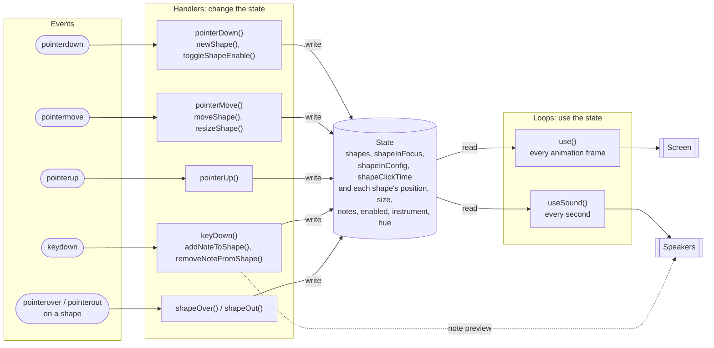
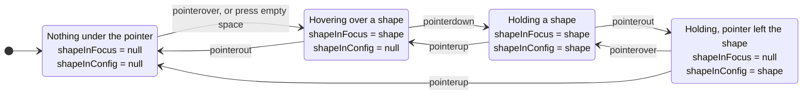
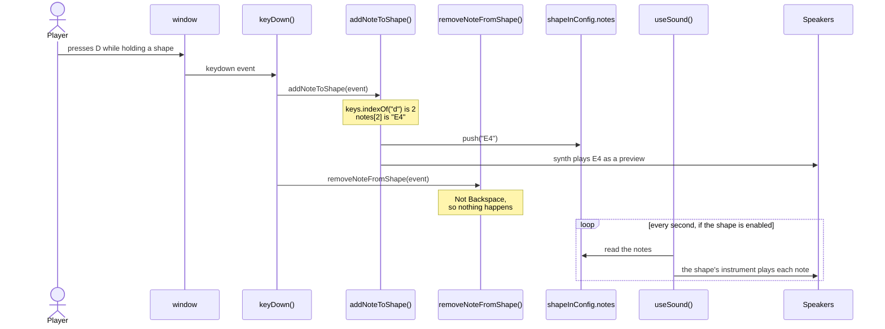
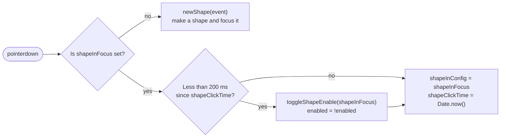
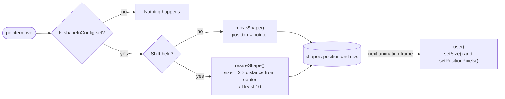

# Musical Instrument

This browser program lets you create and move colored shapes. Each shape can
store notes and play them using a Tone.js instrument.

## How to use

1. Click an empty area to create a shape. The new shape becomes focused; press
   it again to start configuring it.
2. Press and hold a focused shape, then move the pointer to move it.
3. Hold **Shift** while moving the pointer to resize the shape.
4. Quickly press a shape twice, with less than 200 ms between presses, to
   enable or disable its repeating notes.
5. While holding the pointer down on a shape, press **A, S, D, F, G, H,** or
   **J** to add a note. Press **Backspace** to remove the most recently added
   note.
6. Release the pointer to choose the shape’s instrument based on its location:
   - Top-left: FM synth
   - Top-right: membrane synth
   - Bottom-left: pluck-like synth
   - Bottom-right: duo synth

Enabled shapes replay their stored notes about once per second. Larger shapes
play louder, up to the maximum velocity.

## Code flow

`setup()` in `script.js` starts the update, drawing, and sound loops, and
registers the window event handlers. The handlers pass input to smaller helper
functions, which update the program's state. The drawing and sound loops then
use that state.

The program has two halves that never call each other. On the left, events run
handlers that only **change the state**. On the right, two loops run on their
own timers, **read the state**, and turn it into pictures and sound. The state
in the middle is the only thing connecting them.

> **Interactive version:** the [code flow explorer](https://dkadish.github.io/kd402d-a3-pointer-instrument/docs/code-flow.html) shows every
> function and variable in one diagram. Its step-by-step walkthroughs show the
> state changing as you go. You can also open the file locally:
> [`docs/code-flow.html`](docs/code-flow.html).

### Focus and configuration

The program tracks two different shape states:

- `shapeInFocus` is the shape currently under the pointer. When a shape is
  created, `setShapeEventListeners()` attaches `pointerover` and `pointerout`
  listeners to its element. The pointer-over listener calls `shapeOver()` to
  assign that shape to `shapeInFocus`; pointer-out calls `shapeOut()` to clear
  it.
- `shapeInConfig` is the shape currently being edited. On a window
  `pointerdown`, `pointerDown()` copies `shapeInFocus` into `shapeInConfig`.
  Pointer movement and note-key presses act on this configured shape. If there
  is no focused shape on pointer-down, `pointerDown()` creates one instead;
  that new shape is focused, but is not configured until a later press.

When the pointer is released, `pointerUp()` assigns the configured shape's
instrument and colour based on its quadrant, then clears `shapeInConfig`.
Pointer-out clears focus independently; it does not itself end configuration.
This is why the pointer can move a configured shape even if it is no longer
the currently focused shape.

The *Outside* state happens when you shrink a shape with Shift until the
pointer is no longer over it. ([Walkthrough](https://dkadish.github.io/kd402d-a3-pointer-instrument/docs/code-flow.html#resize-4))

### Adding notes

1. `setup()` registers `keyDown()` for the window's `keydown` event.
2. `keyDown()` calls `addNoteToShape()` for each key press.
3. `addNoteToShape()` continues only if a shape is being configured and the key
   is not an auto-repeat. It looks up the key in `keys`, uses the matching
   index to select a note from `notes`, and appends that note to the shape's
   `notes` array.
4. The helper also plays the note immediately with `synth` as an audible
   preview. Later, `useSound()` plays stored notes through that shape's
   selected instrument when the shape is enabled.

([Walkthrough](https://dkadish.github.io/kd402d-a3-pointer-instrument/docs/code-flow.html#notes))

### Removing notes

1. `setup()` registers `keyDown()` for `keydown` events.
2. `keyDown()` calls `removeNoteFromShape()` after checking for an added note.
3. `removeNoteFromShape()` checks for **Backspace** and an active configured
   shape. If both are true, it calls `pop()` on the shape's `notes` array,
   removing the last note. If the array is empty, `pop()` has no effect.

### Enabling and disabling shapes

1. `setShapeEventListeners()` attaches `pointerover` and `pointerout` listeners
   to each new shape. They call `shapeOver()` and `shapeOut()` to set or clear
   `shapeInFocus`, identifying the shape currently under the pointer.
2. `setup()` registers `pointerDown()` for window `pointerdown` events. If a
   shape is focused, `pointerDown()` compares the current time with
   `shapeClickTime`. A second press within 200 ms calls `toggleShapeEnable()`;
   that function flips the shape's `enabled` value. Each press also starts
   configuration and updates `shapeClickTime`.
3. `use()` shows enabled shapes with a bright colour. `useSound()` plays their
   stored notes; disabled shapes are dimmed and are skipped by the sound loop.

This is every path through `pointerDown()`:

([Walkthrough](https://dkadish.github.io/kd402d-a3-pointer-instrument/docs/code-flow.html#toggle))

### Moving shapes

Moving and resizing both start from `pointerMove()`. Neither one draws
anything: it changes the state, and `use()` draws the result on the next frame.

1. Pressing a focused shape triggers `pointerDown()`, which stores it in
   `shapeInConfig`.
2. While it is configured, pointer movement triggers `pointerMove()`. If Shift
   is not held, `pointerMove()` calls `moveShape()`.
3. `moveShape()` stores the pointer's `clientX` and `clientY` as the shape's
   center position.
4. The animation loop calls `use()`, which converts that center to the
   top-left coordinates required by `setPositionPixels()` and redraws the
   shape.

([Walkthrough](https://dkadish.github.io/kd402d-a3-pointer-instrument/docs/code-flow.html#move))

### Resizing shapes

1. Pressing a focused shape starts configuration through `pointerDown()`.
2. While moving the pointer with Shift held, `pointerMove()` calls
   `resizeShape()` instead of `moveShape()`.
3. `resizeShape()` measures the pointer's horizontal and vertical distance
   from the shape's stored center. It uses the larger distance to keep the
   shape square, doubles that distance to get the full size, and enforces a
   minimum of 10 pixels.
4. The next animation frame calls `use()`, which applies the new size and
   adjusts the drawn position around the stored center.

([Walkthrough](https://dkadish.github.io/kd402d-a3-pointer-instrument/docs/code-flow.html#resize))

Releasing the pointer triggers `pointerUp()`. It selects the instrument and
colour from the shape's screen quadrant, then clears `shapeInConfig` to end
configuration. ([Walkthrough](https://dkadish.github.io/kd402d-a3-pointer-instrument/docs/code-flow.html#release))

## API reference

The main input and behavior functions are in `script.js`:

| Function                     | Role                                                                                             |
| ---------------------------- | ------------------------------------------------------------------------------------------------ |
| `setup()`                    | Starts the loops and registers the window event handlers.                                        |
| `pointerDown(event)`         | Creates a shape or begins configuring a focused shape; toggles playback on a quick second press. |
| `pointerMove(event)`         | Chooses between moving and resizing the configured shape.                                        |
| `pointerUp(event)`           | Selects the instrument and colour from the shape's quadrant, then ends configuration.            |
| `keyDown(event)`             | Routes key presses to the note-add and note-remove helpers.                                      |
| `use()`                      | Applies shape appearance and position on each animation frame.                                   |
| `useSound()`                 | Replays notes for enabled shapes about once per second.                                          |
| `moveShape(event)`           | Stores the pointer coordinates as the configured shape's center.                                 |
| `resizeShape(event)`         | Calculates a square shape size from its center-to-pointer distance.                              |
| `addNoteToShape(event)`      | Maps a note key, stores the note, and plays a preview.                                           |
| `removeNoteFromShape(event)` | Removes the last stored note when Backspace is pressed.                                          |
| `toggleShapeEnable(shape)`   | Flips the shape's enabled state.                                                                 |

## Notes

The browser may require a user interaction before it allows audio playback.
Creating a shape calls `Tone.start()` to start Tone.js audio.

The instrument choices are configured in `script.js`. Although a metal synth
is created there, the current quadrant selection does not assign it to shapes.
